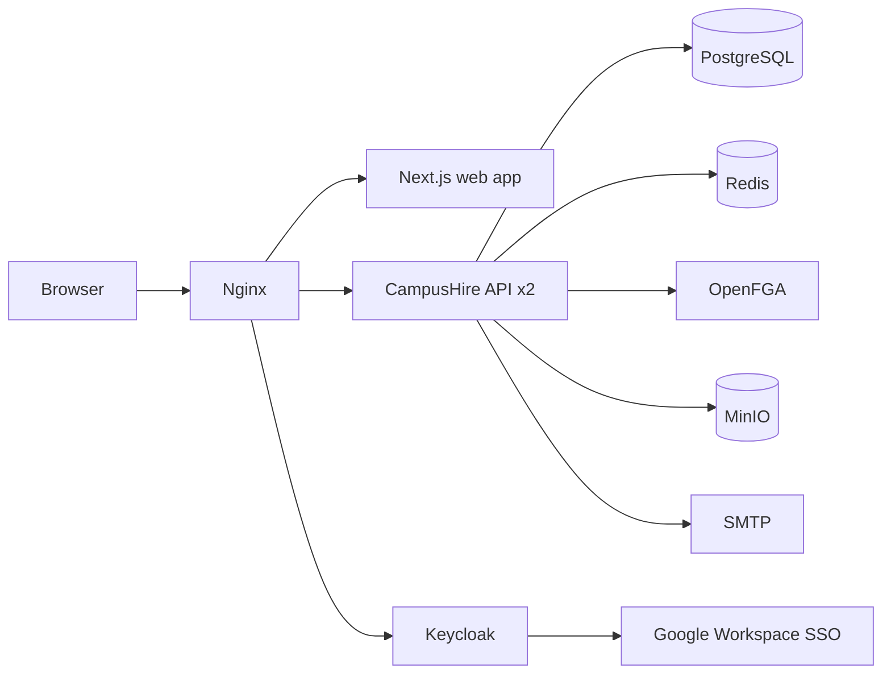

# CampusHire Architecture

CampusHire is a Training & Placement CRM/ERP built as an application of **BM4A** (Base Model For All), a
metadata-driven, multi-tenant platform. This page is the map; decisions are recorded as ADRs.

| ADR | Topic | Location |
|-----|-------|----------|
| 001 | Dynamic record storage (relational metadata + JSONB) | [bm4a/docs/architecture](bm4a/docs/architecture/ADR-001-dynamic-record-storage.md) |
| 002 | Tenancy, identity and OpenFGA authorization | [bm4a/docs/architecture](bm4a/docs/architecture/ADR-002-tenancy-and-authorization.md) |
| 003 | CampusHire as an application of BM4A (hybrid model) | [docs/architecture](docs/architecture/ADR-003-campushire-on-bm4a.md) |
| 004 | Organization roles, module permissions, record scopes, field security | [bm4a/docs/architecture](bm4a/docs/architecture/ADR-004-roles-and-scoped-permissions.md) |
| 005 | File storage and bulk Excel/CSV data exchange | [bm4a/docs/architecture](bm4a/docs/architecture/ADR-005-files-and-bulk-data-exchange.md) |
| 006 | Capacity plan for 10,000 users on a single host | [docs/architecture](docs/architecture/ADR-006-scaling-to-10k-users.md) |
| 007 | Workflow engine, notifications and metadata caching | [bm4a/docs/architecture](bm4a/docs/architecture/ADR-007-workflow-notifications-and-caching.md) |

Product scope, user stories and the app-pack data model: [docs/PRD.md](docs/PRD.md).

## System overview



| Component | Technology | Responsibility |
|-----------|------------|----------------|
| Web app | Next.js 16, React 19, TypeScript, Tailwind 4, shadcn/ui, TanStack Query/Table | Role dashboards, metadata-driven tables and forms, import wizard, pipeline board, admin builder |
| API | Java 25, Spring Boot 4, Spring Modulith, virtual threads | BM4A platform modules + CampusHire domain modules in one modular monolith |
| Identity | Keycloak 26 (OIDC, PKCE), Google IdP | Login, SSO, MFA, password reset; API validates JWTs locally |
| Authorization | OpenFGA 1.22 | Organization and module relations (ReBAC); fail closed |
| Database | PostgreSQL 18 | Metadata, JSONB records, projections, outbox, audit |
| Cache / fan-out | Redis 8 | Schema/analytics cache, rate limits, SSE pub/sub |
| Object storage | MinIO (S3 API) | Resumes, offer letters, photos, import files |
| Edge | Nginx | TLS, compression, static caching, rate limiting, load balancing |
| CI/CD | Jenkins, GitHub Actions | Build, test (Testcontainers), images, deploy, smoke test |

## Backend modules

Spring Modulith modules, each with a published root package and private `internal`/`web` packages. Boundaries are
verified by `ModularityTests` in both `bm4a/platform` and `backend`.

**BM4A platform** (`bm4a/platform`, `com.bm4a.platform.modules`)

| Module | Responsibility |
|--------|----------------|
| `shared` | Problem details, paging, ETags, correlation IDs |
| `identity` | OAuth2 resource server, JWT validation |
| `users` | Internal users keyed by `(issuer, subject)`, `/me` |
| `authorization` | `AuthorizationService` port, OpenFGA adapter, tuple outbox |
| `tenancy` | Organizations, memberships, `TenantContext`, invitations |
| `access` | Organization roles, module permissions, record scopes, field security (ADR-004) |
| `metadata` | Modules, 17 field types, layouts, versions, schema cache |
| `records` | Generic JSONB record engine, history, owner, scopes |
| `relationships` | 1:1, 1:N, N:M links |
| `workflow` | State machines on select fields, transitions, history (ADR-007) |
| `files` | Object storage, MIME sniffing, scoped downloads (ADR-005) |
| `dataexchange` | Excel/CSV templates, import jobs, exports (ADR-005) |
| `notifications` | In-app + SSE, email outbox (ADR-007) |
| `audit` | Append-only audit trail |
| `ratelimit` | Redis write limits |

**CampusHire** (`backend`, `com.campushire`)

| Module | Responsibility |
|--------|----------------|
| `apppack` | Installs/upgrades modules, relationships, roles, workflow, layouts into an organization |
| `onboarding` | Links Google-authenticated students to their records; recruiter/coordinator invitations |
| `projections` | Typed tables maintained from record events; rebuild |
| `placement` | Eligibility engine, drives lifecycle, apply/withdraw, pipeline bulk operations, offers and policy |
| `analytics` | KPIs, breakdowns, funnel, trends, Excel/PDF reports, dashboards |

## Request lifecycle

1. Nginx terminates TLS and forwards to an API replica.
2. `identity` validates the bearer token (signature, issuer, audience, expiry) using cached JWKS.
3. `users` resolves `CurrentUser` (JIT provisioning on first request).
4. `access` / `tenancy` verify membership, organization status and the OpenFGA relation, then compute the
   record scope and field policy for the caller's role.
5. The service runs one transaction; record changes publish `RecordEvent`s into the outbox.
6. After commit, listeners update projections, workflow history, notifications and OpenFGA tuples asynchronously.

## Repository layout

```
campushire/
  bm4a/              BM4A platform (git subtree): platform/, infrastructure/, docs/, scripts/
  backend/           CampusHire Spring Boot application (com.campushire)
  frontend/          Next.js web application
  infrastructure/    Local development stack (Docker Compose)
  deploy/            Production compose, Nginx, Jenkinsfile, backups
  loadtest/          k6 scenarios and data seeding
  docs/              PRD, CampusHire ADRs, API guide, operations
  scripts/           Developer scripts (tokens, seed, smoke test)
```

Flyway migrations: platform `V1..V999` in `bm4a/platform/src/main/resources/db/migration`, CampusHire `V1000+` in
`backend/src/main/resources/db/migration/campushire`.

## Local ports

| Service | Port |
|---------|------|
| Web app | 3000 |
| API | 8090 (container 8080) |
| PostgreSQL | 5442 |
| Keycloak | 8180 |
| OpenFGA | 8280 |
| Redis | 6389 |
| MinIO API / console | 9100 / 9101 |
| Mailpit UI / SMTP | 8025 / 1025 |
