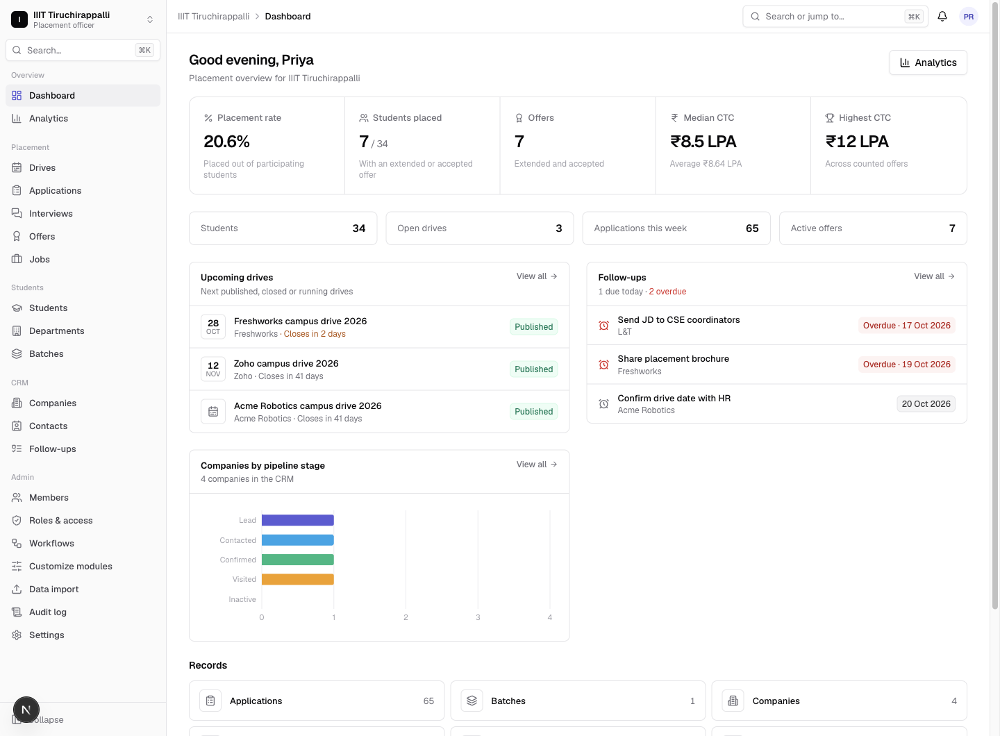
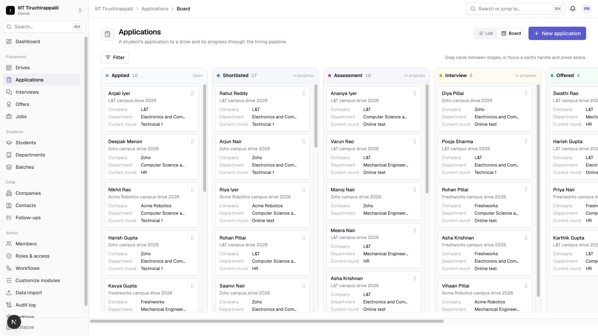
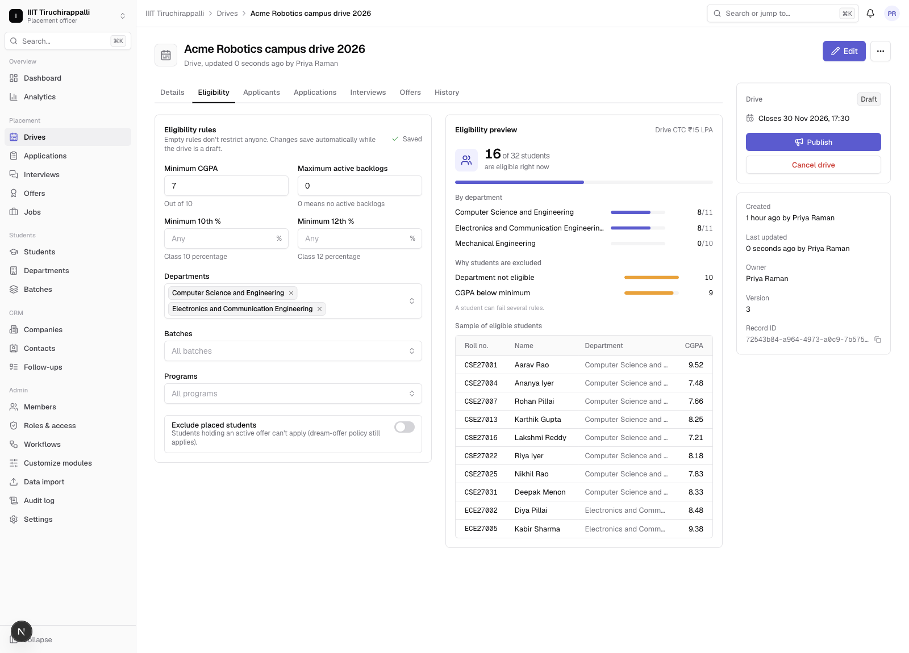
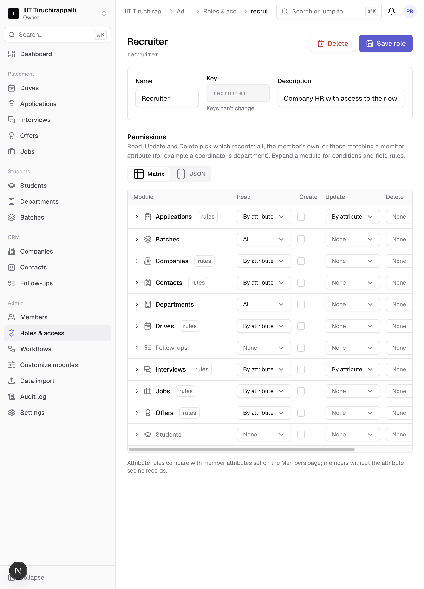
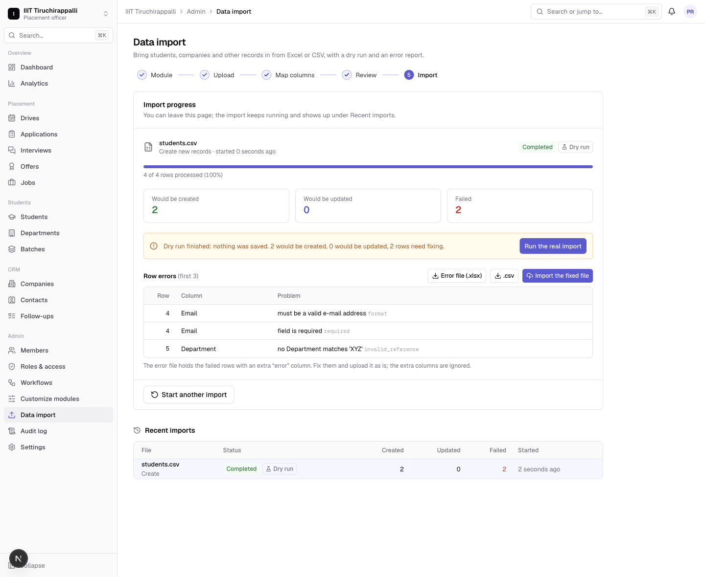
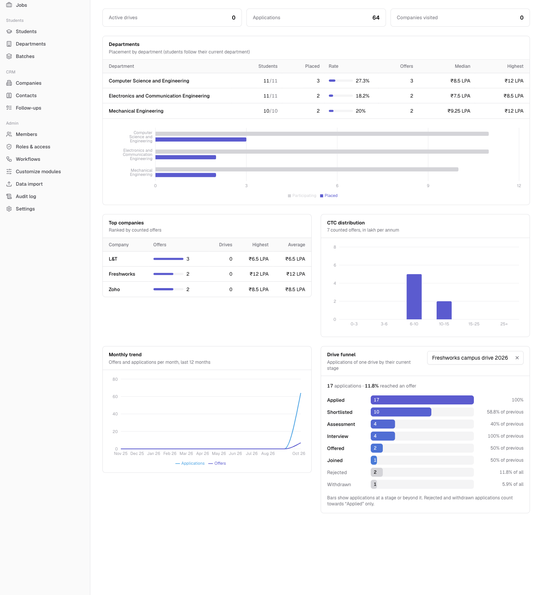
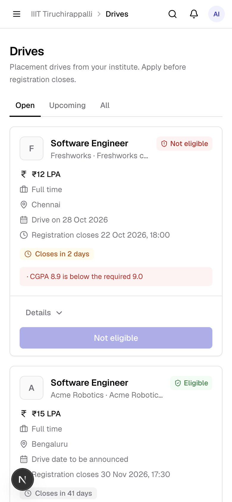
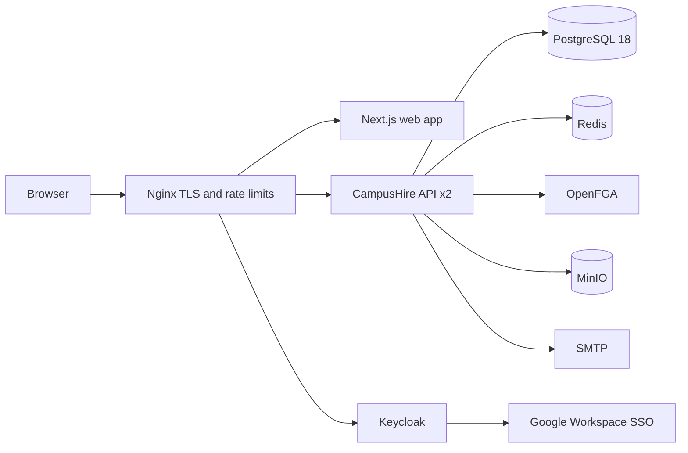

# CampusHire

**Training & Placement CRM/ERP for colleges** - students, departments, companies, drives, applications,
interviews and offers in one place, built as an application of **BM4A** ("Base Model For All"), a
metadata-driven, multi-tenant platform I built alongside it.

The placement cell imports students from Excel, publishes drives with eligibility rules, students sign in with their
college Google account and apply in one click, recruiters shortlist their own applicants, and everyone sees live
placement analytics - with role-based access enforced on every record and field.



| | |
|---|---|
|  |  |
|  |  |
|  |  |

## What it does

**Placement officer (TPO)** - sets up the institute in one click (installs the CampusHire app pack), imports
students from Excel/CSV with a dry run and a downloadable error report, runs the company CRM (contacts, follow-ups,
pipeline stages), creates drives with eligibility rules (CGPA, backlogs, departments, batches, programs, 10th/12th,
placement policy) and a live preview of who qualifies, moves applicants through the hiring pipeline on a Kanban
board or by uploading a shortlist of roll numbers, records offers, and downloads Excel/PDF placement reports.

**Department coordinator** - sees and verifies only their department's students and applications.

**Student** - signs in with the college Google account (linked to their record automatically by e-mail), completes
their profile (academic fields are read-only), sees open drives with the exact reasons when not eligible
("CGPA 6.8 is below the required 7.0"), applies, tracks every stage, and accepts or declines offers. Real-time
notifications in the app and by e-mail.

**Recruiter** - joins by invitation, sees only their company's drives and applicants (no phone numbers or dates of
birth), downloads resumes, shortlists in bulk.

**Admins can change the data model without a deployment**: add fields to any module, rearrange forms with a
drag-and-drop layout builder, edit the application workflow (stages, allowed moves per role) and role permissions.

## Architecture



- **Modular monolith** (Spring Boot 4, Java 25, Spring Modulith): BM4A platform modules (identity, tenancy, access,
  metadata, records, relationships, workflow, files, data exchange, notifications, audit, packs) plus CampusHire
  modules (app pack, onboarding, projections, placement, analytics, dashboard). Module boundaries are verified in
  tests.
- **Metadata-driven records** (ADR-001): modules and 17 field types are data; records are JSONB with canonical
  values, optimistic concurrency, history, soft delete and uniqueness. CampusHire's 11 modules are a declarative
  *app pack* installed into an institute.
- **Three-layer authorization** (ADR-004): OpenFGA relationship checks per module, SQL record scopes (own, by
  department/company attribute, filters) on every read/write/export, and field-level security (hidden/read-only).
- **Typed projections** (ADR-003): record events (transactional outbox) maintain relational tables for eligibility
  and analytics; eligibility for every student is one indexed SQL query, property-tested against the Java rules.
- **Async and real-time**: Excel/CSV import jobs on virtual threads (`SKIP LOCKED` workers), e-mail outbox with
  retries, Server-Sent Events fanned out across replicas through Redis pub/sub, Redis caches with circuit breakers.
- **Built for one college server** (ADR-006): stateless API replicas behind Nginx, connection budget and PostgreSQL
  tuning for 10,000 users on 8 vCPU / 16 GB.

Details: [Architecture.md](Architecture.md), [product requirements](docs/PRD.md), ADRs in
[docs/architecture](docs/architecture) and [bm4a/docs/architecture](bm4a/docs/architecture), API references in
[docs/api](docs/api) and [bm4a/docs/api](bm4a/docs/api/README.md).

## Tech stack

| Layer | Technology |
|-------|------------|
| Web | Next.js 16, React 19, TypeScript, Tailwind CSS 4, Radix/shadcn-style components, TanStack Query and Table, react-hook-form + zod, dnd-kit, Recharts |
| API | Java 25, Spring Boot 4.1, Spring Modulith, Spring Security (OAuth2 resource server), JDBC, Flyway, Apache POI, Commons CSV, OpenPDF, Thymeleaf mail |
| Identity and access | Keycloak 26 (OIDC + PKCE, Google IdP, branded login theme), OpenFGA |
| Data | PostgreSQL 18 (JSONB, GIN, materialized views), Redis 8, MinIO (S3) |
| Delivery | Docker Compose, Nginx, Jenkins, GitHub Actions, Prometheus + Grafana, k6 |
| Tests | JUnit 5, Testcontainers (PostgreSQL, OpenFGA, Redis, Mailpit, MinIO), Spring Modulith tests - 244 automated tests |

## Run it locally

Prerequisites: Docker, JDK 25, Node.js 22, `make`, `curl`, `jq`.

```bash
cp infrastructure/.env.example infrastructure/.env
cp backend/.env.example backend/.env
make infra-up        # PostgreSQL, Keycloak, OpenFGA, Redis, MinIO, Mailpit
make backend         # API on http://localhost:8090 (new terminal)
make frontend        # web app on http://localhost:3000 (new terminal)
make seed            # optional: demo institute with 2,000 students, companies, drives and offers
```

Sign in at <http://localhost:3000> (development accounts, password `dev-password-1`): `tpo@campushire.dev`
(placement officer), `coordinator.cse@campushire.dev`, `student1@iiitt.ac.in`, `recruiter@acme.dev`.
E-mails land in Mailpit at <http://localhost:8025>. "Continue with Google" needs an OAuth client: put `GOOGLE_*` in
`infrastructure/.env` and run `make google-sso`.

| Service | URL |
|---------|-----|
| Web app | http://localhost:3000 |
| API (+ Swagger UI at `/swagger-ui.html`) | http://localhost:8090 |
| Keycloak | http://localhost:8180 |
| Mailpit | http://localhost:8025 |
| MinIO console | http://localhost:9101 |

`make test` runs the platform and backend test suites (needs Docker); `make help` lists every target.

## Deploy

One server with Docker: `deploy/docker-compose.prod.yml` (Nginx with TLS, two API replicas, Keycloak, PostgreSQL,
OpenFGA, Redis, MinIO, optional Prometheus/Grafana), backups and restore scripts, a Jenkins pipeline and a
step-by-step guide: [docs/operations/DEPLOYMENT.md](docs/operations/DEPLOYMENT.md).

## Repository layout

```
bm4a/            BM4A platform (git subtree): platform/ (Spring Boot), docs/, infrastructure/
backend/         CampusHire application (com.campushire) and its migrations (V1000+)
frontend/        Next.js web app
infrastructure/  Local development stack and Keycloak realm/theme
deploy/          Production compose, Nginx, Keycloak production realm, monitoring, scripts, Jenkinsfile
loadtest/        k6 scenarios; scripts/seed/ demo and load data seeder
docs/            PRD, CampusHire ADRs, API references, operations guides
```

## Status and next steps

- **Load test**: the k6 scenarios (1,500 students applying during a drive spike) and the 10,000-student seeder are
  ready; the run is to be done on the target server - see [docs/operations/load-test.md](docs/operations/load-test.md).
  Measured so far: analytics over 10,000 students and 200,000 applications answer in under 50 ms (integration test).
- **Security review**: a dedicated review of authorization paths, uploads and spreadsheet handling is planned
  before the college rollout; the design and tests cover tenant isolation, record scopes, field security, file
  sniffing and formula-injection escaping.
- Smaller follow-ups: audit log page in the UI, recruiters scheduling interviews themselves, institute name and
  Unicode fonts in the PDF report.

## Author

Bhuvan M Acharya - built for the Training & Placement cell of IIIT Tiruchirappalli.
