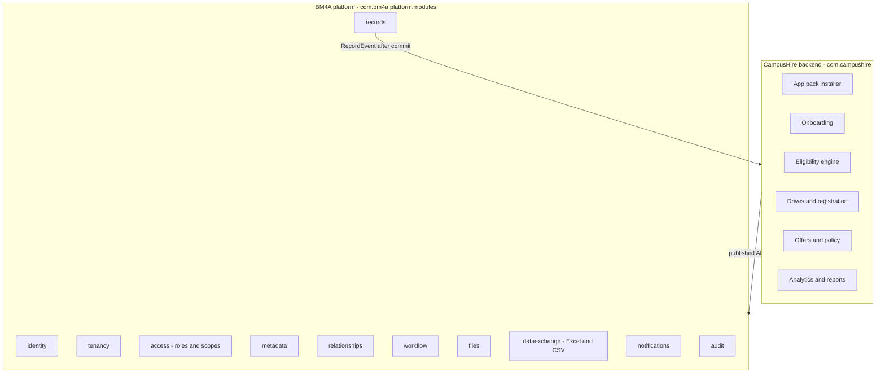

# ADR-003: CampusHire as an application of the BM4A platform

Status: Accepted (2026-10-20)

## Context

CampusHire is the Training and Placement (T&P) CRM/ERP for a college: students, departments, companies, jobs,
drives, applications, interviews and offers, used by four kinds of people (Training & Placement Officer, department
coordinators, students, recruiters). BM4A is a metadata-driven, multi-tenant platform (ADR-001, ADR-002) that already
provides identity, tenancy, OpenFGA authorization, a module/field builder, a generic JSONB record engine,
relationships and an append-only audit trail.

Building CampusHire as a classic CRUD application (one JPA entity and controller per concept) would duplicate most
of BM4A and freeze the data model: every college tracks slightly different student attributes (10th/12th marks,
gap years, category, hostel, ...). Building it purely as metadata would push domain rules that need strong
guarantees (eligibility, "one registration per drive", offer policies, analytics) into generic engines that are not
designed for them.

## Decision

**Hybrid: metadata for the shape of the data, Java for the rules that must hold.**

1. **One deployable.** `backend/` is a Spring Boot application (`CampusHireApplication`) that component-scans the
   BM4A modules (`bm4a/platform`, consumed as a library jar) and the CampusHire modules. Spring Modulith verifies
   the boundaries of both (`ModularityTests`). CampusHire code may only use the published (root package) API of a
   platform module, never `internal` or `web` packages.
2. **App pack.** CampusHire's data model is a versioned, idempotent *app pack*: module definitions (`department`,
   `batch`, `student`, `company`, `contact`, `follow_up`, `job`, `drive`, `application`, `interview`, `offer`),
   relationships, layouts, organization roles (TPO, coordinator, student, recruiter, ADR-004) and the application
   workflow (ADR-007). Installing the pack into an organization calls the platform services; colleges can then add
   their own fields and layouts through the admin UI without a deployment.
3. **Typed projections for rules and analytics.** Where CampusHire needs relational guarantees or fast typed
   queries it owns plain tables (Flyway `V1000+` in `backend/src/main/resources/db/migration/campushire`):
   - `campushire_student_projection` - typed copy of the eligibility-relevant student fields (CGPA, backlogs,
     department, batch, placement status, offer count, highest CTC);
   - `campushire_drive_registration` - `UNIQUE (drive_id, student_id)` makes applying idempotent under races;
   - `campushire_application_projection`, `campushire_offer_projection` - pipeline and offer facts for analytics;
   - `campushire_placement_stats` - materialized view refreshed concurrently on a schedule.
   Projections are maintained by `RecordEvent` listeners (Spring Modulith `@ApplicationModuleListener`: after
   commit, asynchronous, persisted in the event publication registry and retried) and can be rebuilt from records
   at any time. Records remain the source of truth.
4. **Domain endpoints for domain operations.** Generic record CRUD is used for data management (students,
   companies, ...). Operations with rules get dedicated endpoints under `/api/v1/orgs/{orgId}/campushire/...`
   (apply to a drive, publish a drive, bulk status changes, accept an offer, analytics, reports). They run the same
   tenant and permission checks as the platform.

## Consequences

- Data model changes for a college are configuration, not code; domain invariants stay in tested Java code.
- Two representations of some facts (JSONB record + typed projection). Projections are eventually consistent
  (typically well under a second); operations that must be exact (apply, offer acceptance) re-read the record
  inside their transaction instead of trusting the projection.
- Platform improvements made for CampusHire (roles, files, imports, workflow, notifications) are generic and are
  contributed back to BM4A with `git subtree push --prefix=bm4a`.
