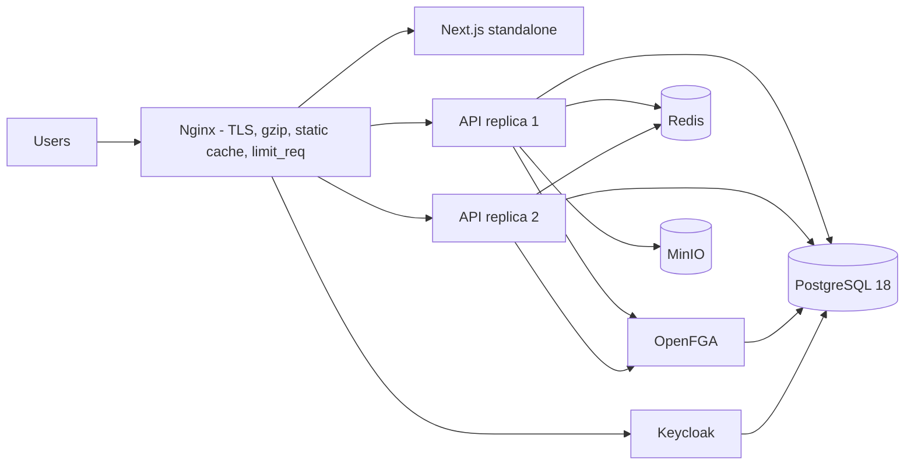

# ADR-006: Capacity plan for 10,000 users on a single host

Status: Accepted (2026-10-20)

## Workload model

| Population | Count | Behavior |
|------------|-------|----------|
| Students | ~9,000 (4 batches) | Mostly idle; bursts when a drive opens or results are announced |
| Coordinators / TPO staff | ~100 | Steady CRUD, imports, exports, analytics |
| Recruiters | ~500 | Shortlisting, exports, low volume |

Design peak: a popular drive opens and **1,500 students are active within 10 minutes**, each issuing about one API
call every 3-5 seconds (list drives, view drive, apply, poll status): **~300-500 requests/s** for a few minutes.
Data volume per year: ~10k students, ~200k applications, ~1M record versions, ~2M audit events: small for PostgreSQL.

## Topology

Reference host: 8 vCPU, 16 GB RAM, SSD (an ordinary college server or cloud VM). All services run with Docker
Compose; no Kubernetes is needed at this scale, and everything stays portable to it.

## Decisions

1. **Stateless API, two replicas** behind Nginx (`least_conn`, health-checked). Sessions live in Keycloak tokens;
   SSE fan-out uses Redis pub/sub (ADR-007); background jobs use `SKIP LOCKED` claims, so any replica can run them.
   Scaling out is `docker compose up --scale` plus an upstream entry.
2. **Java 25 virtual threads** for request handling and jobs: blocking JDBC and HTTP calls (OpenFGA) do not pin
   platform threads; concurrency is bounded by the connection pool, not the thread pool.
3. **Connection budget**: HikariCP 30 per replica (60) + Keycloak 20 + OpenFGA 20 < `max_connections = 200`.
   PostgreSQL tuned for 16 GB: `shared_buffers=4GB`, `effective_cache_size=12GB`, `work_mem=16MB`,
   `maintenance_work_mem=512MB`, `random_page_cost=1.1`.
4. **Token validation is local** (JWKS cached in the API); Keycloak only sees logins and refreshes
   (~10k users / 5-minute token lifetime = at most ~35 refreshes/s).
5. **Caching** (Redis, never a source of truth): module schemas (ADR-007), role documents, drive details (30 s),
   analytics responses (60 s). Analytics read a materialized view refreshed concurrently every 5 minutes.
6. **Write path of the hot spot (apply to drive)** is a single short transaction: read the student projection,
   check eligibility, `INSERT ... ON CONFLICT DO NOTHING` into `campushire_drive_registration`, create the
   application record. No row lock on the drive; duplicates from double clicks or retries are absorbed by the
   unique constraint and return the existing application (`200`) instead of an error.
7. **Back-pressure**: Nginx `limit_req` per client IP (burst-friendly), BM4A Redis write limits per user, request
   body limits (26 MB uploads), import concurrency of one job per module per organization.
8. **Indexes** for every list path: record scope `(organization_id, module_id, created_at)`, owner
   `(organization_id, module_id, owner_user_id)`, JSONB GIN `jsonb_path_ops`, projection indexes on
   `(organization_id, department_id, batch_id)`, `(organization_id, cgpa)`, `(drive_id, status)`.

## Verification

`loadtest/` contains k6 scenarios to run against the production compose file with 10,000 seeded students
(`make seed-load`): `drive-spike` (ramp to 1,500 virtual users applying and polling), `browse` (mixed reads),
`staff` (imports, exports, analytics). Targets: **p95 < 300 ms for reads, p95 < 500 ms for apply, error rate
< 0.1%**. The full run is executed on the target server, not on a development laptop; the procedure and the
results table are in `docs/operations/load-test.md`. Already measured in integration tests: analytics over 10,000
students, 3,000 offers and 200,000 applications in < 50 ms (warm), 5,000-row XLSX import in about 14 s, and 20
concurrent applies by one student producing exactly one application.

## Growth path

Beyond one host: move PostgreSQL to a dedicated machine (or managed service) with a streaming replica for analytics
and backups, add PgBouncer in transaction mode, run more API replicas on additional hosts behind the same Nginx.
No code changes are required for any of these steps.
