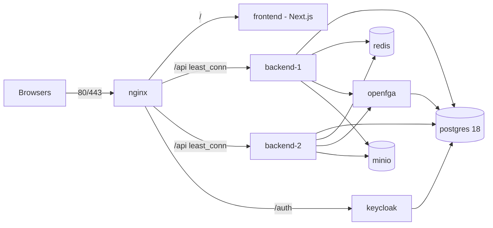

# Deploying CampusHire on one server

Production runs as one Docker Compose project (`campushire-prod`, file `deploy/docker-compose.prod.yml`) on a single
host, sized for 10,000 users ([ADR-006](../architecture/ADR-006-scaling-to-10k-users.md)). The load test procedure
is in [load-test.md](load-test.md); it has not been executed yet.



Only nginx publishes ports. Everything else is reachable on the internal network `campushire-prod` only.

| Service | Image | Notes |
|---------|-------|-------|
| nginx | `nginx:stable-alpine` | TLS, HTTP/2, gzip, static caching, rate limits, `/api` to both replicas, `/auth` to Keycloak |
| frontend | `campushire-frontend:${IMAGE_TAG}` | Built from `frontend/Dockerfile`; the public Keycloak URL is baked in at build time |
| backend-1, backend-2 | `campushire-backend:${IMAGE_TAG}` | `SPRING_PROFILES_ACTIVE=prod`, Hikari 30 each, readiness health check |
| keycloak | `quay.io/keycloak/keycloak:26.3` | Production mode (`start`), served under `/auth`, realm from `deploy/keycloak/campushire-realm.json` |
| postgres | `postgres:18` | Tuned per ADR-006 (`PG_*` in `.env`), `pg_stat_statements`, databases created by `deploy/postgres/init` |
| openfga | `openfga/openfga:v1.22.0` | Pre-shared key; store and model created once by `deploy/scripts/openfga-bootstrap.sh` |
| redis | `redis:8.2` | Password, `maxmemory` + `allkeys-lru`, no persistence (cache, rate limits and SSE fan-out only) |
| minio | `pgsty/minio` | Private bucket and a least-privilege API key created by `minio-init` (`infrastructure/minio/init/create-bucket.sh`) |
| prometheus, grafana | `prom/prometheus`, `grafana/grafana` | Optional profile `monitoring` (section 10) |

## 1. Server

Ubuntu Server 24.04 LTS, 8 vCPU, 16 GB RAM, 100 GB SSD (database plus files; size MinIO for resumes and offer
letters), a DNS name (for example `placements.iiitt.ac.in`) and inbound TCP 80 and 443. Smaller machines work with
lower `PG_*`, `*_MEM_LIMIT` values (see the comments in `.env.example`).

```bash
sudo apt-get update && sudo apt-get install -y ca-certificates curl git jq make openssl
sudo install -m 0755 -d /etc/apt/keyrings
sudo curl -fsSL https://download.docker.com/linux/ubuntu/gpg -o /etc/apt/keyrings/docker.asc
echo "deb [arch=$(dpkg --print-architecture) signed-by=/etc/apt/keyrings/docker.asc] https://download.docker.com/linux/ubuntu $(. /etc/os-release && echo "$VERSION_CODENAME") stable" \
  | sudo tee /etc/apt/sources.list.d/docker.list >/dev/null
sudo apt-get update && sudo apt-get install -y docker-ce docker-ce-cli containerd.io docker-buildx-plugin docker-compose-plugin
sudo usermod -aG docker "$USER"    # log out and in again
```

Firewall: `sudo ufw allow OpenSSH && sudo ufw allow 80,443/tcp && sudo ufw enable`. Docker publishes only nginx.

## 2. Code and configuration

```bash
sudo mkdir -p /opt/campushire && sudo chown "$USER" /opt/campushire
git clone <repository-url> /opt/campushire && cd /opt/campushire
cp deploy/.env.example deploy/.env && chmod 600 deploy/.env

# Replace every change-me secret with a random value (alphanumeric: safe in URLs and shell).
while grep -qE '=change-me-[a-z0-9-]*(password|key)$' deploy/.env; do
  sed -i -E "0,/=change-me-[a-z0-9-]*(password|key)$/s//=$(openssl rand -base64 32 | tr -d '/+=' | cut -c1-32)/" deploy/.env
done
```

Then edit `deploy/.env`:

- `CAMPUSHIRE_DOMAIN` (for example `placements.iiitt.ac.in`). `CAMPUSHIRE_PUBLIC_URL` defaults to
  `https://<domain>`; set it only when `HTTPS_PORT` is not 443 (`https://<domain>:8443`). The token issuer
  (`<public URL>/auth/realms/campushire`), Keycloak's hostname, e-mail links (`APP_BASE_URL`) and the web app's
  login URL all derive from it.
- `GOOGLE_*` (step 6) and `SMTP_*` (step 7), if known now; the realm reads `GOOGLE_*` at first import only.
- Sizing: the defaults are for the 16 GB reference host.

Values must not contain `$`, quotes or spaces (except the quoted `MAIL_FROM` / `BACKEND_JAVA_OPTS`).

Validate the result (also run by CI against `.env.example`):

```bash
make prod-config                  # docker compose -f deploy/docker-compose.prod.yml --env-file deploy/.env config -q
```

## 3. DNS and TLS certificate

Create a DNS `A` record for `CAMPUSHIRE_DOMAIN` pointing at the server (campus DNS for LAN-only installs).

- Public domain: Let's Encrypt. Webroot mode through nginx's `/.well-known/acme-challenge/` location renews without
  downtime, see [deploy/scripts/certbot.md](../../deploy/scripts/certbot.md). Before the first start you can also
  use standalone mode while port 80 is still free:
  `sudo docker run --rm -p 80:80 -v /etc/letsencrypt:/etc/letsencrypt certbot/certbot certonly --standalone -d <domain> --email <you> --agree-tos`,
  then copy `fullchain.pem` / `privkey.pem` into `deploy/certs/` as described there.
- Campus LAN without a public name: `deploy/scripts/gen-self-signed-cert.sh placements.iiitt.lan 192.168.1.20`
  (browsers warn once; distribute the certificate through your device management to avoid it).
- Own CA or purchased certificate: `deploy/certs/fullchain.pem` (with chain) and `deploy/certs/privkey.pem`.

## 4. First start

```bash
make prod-up
```

On the first run this starts PostgreSQL and OpenFGA, runs `deploy/scripts/openfga-bootstrap.sh --write-env` (creates
the store, writes `bm4a/platform/src/main/resources/openfga/model.json`, stores `OPENFGA_STORE_ID` and
`OPENFGA_MODEL_ID` in `deploy/.env`), builds both images and starts everything with `--wait`. The prod profile keeps
in-app bootstrap off on purpose: two replicas starting together could each create a store, and every start would
write a new model version. Keycloak imports the realm on its first start (about a minute).

```bash
make prod-ps                      # all services healthy
make prod-smoke                   # INSECURE=1 for a self-signed certificate
```

The smoke test checks container health, the HTTP to HTTPS redirect, the login page, the issuer in Keycloak's
discovery document, the Keycloak login form, `401` from the API without a token, and that `/actuator` is not served
at the edge.

## 5. First placement officer and institute

```bash
deploy/scripts/create-user.sh tpo@iiitt.ac.in Priya Raman     # prints a one-time password
```

Sign in at `https://<domain>/login`, change the password, then create the institute in the onboarding screen. The
creator becomes the organization owner. Running setup installs the CampusHire app pack and gives them the `tpo` role.
Over the API, setup is `POST /api/v1/orgs/{orgId}/campushire/setup` with `{"allowedEmailDomains": ["iiitt.ac.in"]}`.
Students who sign in with an address in an allowed domain can claim their imported record. Coordinators and
recruiters are invited from the app (see [docs/api/campushire.md](../api/campushire.md)).

The Keycloak admin console is at `https://<domain>/auth/admin/` and nginx only serves it to private networks
(10/8, 172.16/12, 192.168/16, 127.0.0.1). The bootstrap admin is `KEYCLOAK_ADMIN_USER`. Create a personal admin
there and delete the bootstrap one.

## 6. Google sign-in

1. Google Cloud Console, APIs & Services, Credentials, *Create OAuth client ID*, type *Web application*.
   Authorized redirect URI: `https://<domain>/auth/realms/campushire/broker/google/endpoint`. For Google Workspace
   institutes, make the consent screen *Internal*.
2. Before the first start: set `GOOGLE_IDP_ENABLED=true`, `GOOGLE_CLIENT_ID`, `GOOGLE_CLIENT_SECRET` and
   `GOOGLE_HOSTED_DOMAIN` (for example `iiitt.ac.in`; empty allows any Google account) in `deploy/.env`.
3. On a running installation the realm already exists. Either enter the values in the admin console (Identity
   providers, *google*), or run the script from a host on a private network that resolves the domain to the server:
   `ENV_FILE=deploy/.env KC_HOSTNAME=https://<domain>/auth scripts/configure-google-sso.sh`.

The provider trusts Google's verified e-mail, so students land on onboarding with `email_verified=true`.

## 7. E-mail (SMTP)

Set `SMTP_HOST`, `SMTP_PORT`, `SMTP_USERNAME`, `SMTP_PASSWORD`, `SMTP_STARTTLS`/`SMTP_SSL` and `MAIL_FROM`, then
`make prod-up`. Provider examples, retry behaviour and metrics are in
[bm4a/docs/operations/EMAIL.md](../../bm4a/docs/operations/EMAIL.md). Without `SMTP_HOST`, notifications stay
queued and nothing is lost. Keycloak (verification and password reset) uses the same server, read at realm import.
For an existing realm, set it under Realm settings, Email (sender `KEYCLOAK_MAIL_FROM`).

## 8. Backups

`deploy/scripts/backup.sh [--retention-days N] [--no-files]` writes `BACKUP_DIR/<UTC stamp>/` with roles
(`postgres-globals.sql.gz`), one compressed custom-format `pg_dump` per database (`campushire`, `keycloak`,
`openfga`), a copy of the MinIO bucket (`mc mirror` into `BACKUP_DIR/minio-current`, then `rsync --link-dest` so
unchanged files are hard links to the previous snapshot), `SHA256SUMS` and `MANIFEST`. It deletes snapshots older
than N days (default `BACKUP_RETENTION_DAYS`, 14). Jenkins runs it before every deploy.

```bash
sudo mkdir -p /var/backups/campushire && sudo chown "$USER" /var/backups/campushire
crontab -e
# 30 2 * * * cd /opt/campushire && deploy/scripts/backup.sh >> /var/log/campushire-backup.log 2>&1
```

Copy `BACKUP_DIR` off the server (rsync, restic or a NAS mount); a backup on the same disk does not survive a disk
failure. Restore (destructive, stops the stack while it runs):

```bash
deploy/scripts/restore.sh /var/backups/campushire/20261020T023000Z            # --only databases|files, --yes
make prod-smoke
```

Practise a restore on a spare machine every term.

## 9. Upgrades

**Jenkins** (`deploy/Jenkinsfile`, branch `main`): tests, frontend lint/build, then on the `campushire-prod` agent
`compose config`, `compose build --pull`, `openfga-bootstrap.sh --check` (fails when `model.json` changed), backup,
`up -d --wait`, smoke test. The `.env` comes from the secret file credential `campushire-prod-env`. Set `CERTS_DIR`
in it to an absolute path. When the check reports a new model, run `deploy/scripts/openfga-bootstrap.sh --write-env`
on the server and update the credential with the new `OPENFGA_MODEL_ID`.

**Manual**:

```bash
cd /opt/campushire
deploy/scripts/backup.sh
git pull
deploy/scripts/openfga-bootstrap.sh --check || deploy/scripts/openfga-bootstrap.sh --write-env
IMAGE_TAG=$(git rev-parse --short=12 HEAD) make prod-up      # or set IMAGE_TAG in deploy/.env
make prod-smoke
```

Flyway migrates the database when the first replica starts. Spring Boot shuts down gracefully, and nginx retries
idempotent requests on the other replica (`proxy_next_upstream`). **Rollback**: start the previous tag
(`IMAGE_TAG=<old> docker compose -f deploy/docker-compose.prod.yml --env-file deploy/.env up -d`). If a migration
must be undone, restore the pre-deploy backup.

## 10. Monitoring

Optional compose profile `monitoring`: Prometheus (internal only, 15 days retention) scrapes both API replicas,
Keycloak (`:9000/metrics`) and OpenFGA (`:2112`); Grafana is provisioned with the Prometheus data source and the
"CampusHire API" dashboard (requests/s, 5xx ratio, p95 latency per route, heap, Hikari pools, GC, CPU, threads).

```bash
# deploy/.env: GRAFANA_ADMIN_PASSWORD
make prod-up MONITORING=1         # adds prometheus and grafana; make prod-down stops them too
```

Grafana is served at `https://<domain>/grafana/` to private networks only (same rule as the Keycloak admin
console); nginx answers `502` there while the profile is off. Prometheus scrapes `/actuator/prometheus` on the
internal network; nginx never exposes `/actuator`.

| What | How |
|------|-----|
| Container health and resources | `make prod-ps`, `docker stats` |
| Logs (JSON: API in ECS format, Keycloak, OpenFGA; nginx access log with request and upstream times) | `make prod-logs SERVICE=backend-1`; rotated by Docker (5 x 20 MB per container) |
| API health and metrics (internal only) | `docker run --rm --network campushire-prod curlimages/curl -s http://backend-1:8080/actuator/health/readiness` and `.../actuator/prometheus` (Hikari pool, HTTP timings, `bm4a_ratelimit_*`, `bm4a_notifications_*`) |
| Keycloak health and metrics | `http://keycloak:9000/health/ready`, `http://keycloak:9000/metrics` (same network) |
| Slow SQL | `docker compose -f deploy/docker-compose.prod.yml --env-file deploy/.env exec postgres psql -U campushire_admin -d campushire -c "SELECT calls, round(mean_exec_time::numeric,2) ms, query FROM pg_stat_statements ORDER BY total_exec_time DESC LIMIT 15"`; statements slower than `PG_LOG_MIN_DURATION` (500 ms) are logged |
| Rate limiting | nginx `429` in the access log (per token 50 r/s, per IP 2000 r/s); API `429` = `bm4a_ratelimit_rejected_total` |


## 11. Troubleshooting

| Symptom | Cause and fix |
|---------|---------------|
| `backend-*` restarts with `bm4a.authz.openfga.store-id and model-id are required` | Run `deploy/scripts/openfga-bootstrap.sh --write-env`, then `make prod-up` |
| Every API call returns `401` after sign-in | Issuer mismatch: `CAMPUSHIRE_PUBLIC_URL` must be exactly the URL in the browser (scheme, host, port). Check `issuer` at `/auth/realms/campushire/.well-known/openid-configuration` |
| Login redirects to `localhost` or the wrong port | The frontend image was built with another `CAMPUSHIRE_PUBLIC_URL`. Rebuild with `make prod-up` |
| Keycloak "Invalid redirect uri" | The realm was imported with another URL. Fix the `campushire-web` client's redirect URIs and web origins in the admin console |
| nginx exits: `cannot load certificate` | `CERTS_DIR` lacks `fullchain.pem` / `privkey.pem` (step 3) |
| Postgres changes in `.env` (passwords, DB names) have no effect | They apply only when the `postgres-data` volume is created. Change passwords with `ALTER ROLE` |
| `429` for a whole campus | Raise `NGINX_API_IP_RATE`/`NGINX_API_IP_BURST` (NAT); per-user limits stay |
| Uploads fail with `503 file_storage_unavailable` | `minio` unhealthy or `S3_*` mismatch. `docker compose ... logs minio minio-init` |
| Grafana `/grafana/` returns `502` | The monitoring profile is not running: `make prod-up MONITORING=1` |
| `docker compose up --wait` times out on a small machine | First start of Keycloak and Flyway is slow. Re-run `make prod-up`; check `make prod-logs SERVICE=keycloak` |
| E-mails not delivered | `SMTP_HOST` empty or rejected. Pending rows stay in `email_outbox`; see EMAIL.md |

## Configuration notes

- `deploy/docker-compose.prod.yml` sets both the documented short variables (`FILES_STORAGE`, `S3_*`, `SMTP_*`,
  `MAIL_FROM`) and their canonical forms (`BM4A_FILES_*`, `BM4A_NOTIFICATIONS_EMAIL_*`). The CampusHire
  `application.yaml` replaces the platform's `application.yaml` on the classpath and does not map the short names.
- The load-test seeder can add a temporary password-grant client `campushire-loadtest` to the realm (staging only).
  Production realms have no password-grant client. Remove it after tests:
  `scripts/seed/seed.py --target prod --remove-loadtest-client`.
- Memory limits (16 GB host): postgres 6g, backend-1/2 2g each (heap 1.5g), keycloak 1.5g, minio 1g, redis 768m,
  frontend and openfga 512m, nginx 256m (about 14.3 GB). Connection budget: 2 x 30 + 20 + 20 = 100 of 200.
- The production realm (`deploy/keycloak/campushire-realm.json`) is the dev realm without dev users and without the
  password-grant `campushire-cli` client; client URLs, SMTP and Google values are `${ENV}` placeholders filled from
  `deploy/.env` at the first import only.
